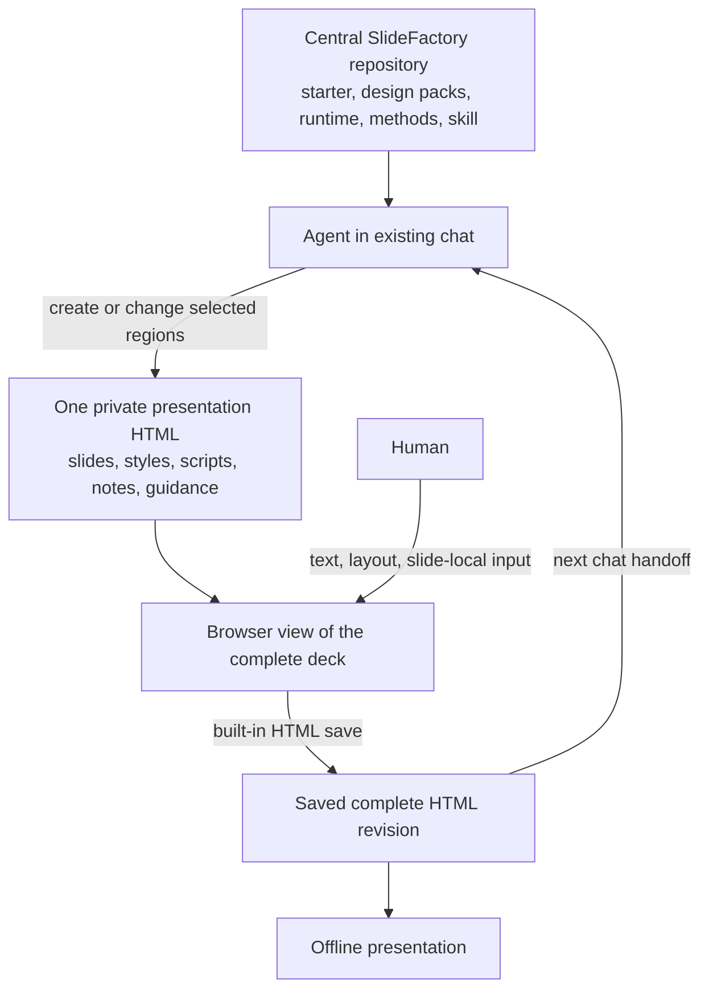

# SlideFactory — accepted solution and architecture

Date: 2026-10-14. User approved implementation; first package and local-operation
editor rewrite built and verified. Dated first-package evidence below remains
historical; current repair evidence
and [ADR-001](../decisions/ADR-001-local-editor-transactions.md) govern the rewrite.
Current implementation contract: [001 working package](../specs/001-working-package.md).
This revision supersedes the earlier per-slide-source/local-save-bridge proposal.
[Intent](../../intent.md), investigation,
[alternatives](../research/2026-10-10-existing-solutions.md).

## Recommendation

Standardize the existing collaboration: **one self-contained HTML file is the
complete presentation and saved handoff artifact**. The user opens it in a
browser, adjusts text/layout, saves input beside a slide, and hands the resulting
file to the LLM in the existing chat. The LLM creates slides and diagrams and
handles fundamental changes.

Keep reusable templates, editor/runtime source, design packs and technical authoring conventions
in the central SlideFactory repository. The packaged agent skill supplies the entry
point for creating and refining decks. No new app, local save server, per-slide
source files or repository per presentation is required initially.

The original council
provides evidence about existing mechanisms and alternatives. It did not review
this precise refinement and does not establish runtime success.

## Starting a new presentation

The entry point is the existing agent chat. For example:

> Use SlideFactory to create a presentation about X in folder Y. Audience: Z.
> Use this visual style/reference and start with this storyline.

The packaged skill directs the agent to SlideFactory's reusable resources and
method. The agent creates a private folder and a complete `presentation.html`,
including runtime, styles and necessary assets. The human opens that one file.
They do not copy editor files or create a new repository. A separate private Git
repository is optional if versioning is useful.

Current status: the [skill](../../skills/slidefactory/SKILL.md), focused helper and
four complete ready files are implemented: two example decks and two empty
counterparts. The user subsequently requested skill
installation; `$slidefactory` now uses a link to the central package. Explicit
file-path invocation also works; no build is needed to start.

The [package layout and new-engagement example](package-layout.md) make the
resource boundaries explicit: the central skill lives inside SlideFactory, and
its ready starter already includes the editor. A new local engagement chat can
read that skill by explicit path. Private outputs remain in
the engagement folder. The user agreed to the compact editing-bar direction.

## Continuing the work

1. Open the whole presentation, adjust text/layout and enter slide-local guidance.
2. Use its built-in HTML save action to obtain the current complete file.
3. Identify that saved file in the existing chat and request the next change.
4. The agent reads its effective slide state and guidance, changes the relevant
   regions and returns the next complete HTML revision.
5. Open the returned presentation and continue.

There is one file per saved presentation revision, rather than one per slide.
Inserting/deleting a slide changes a section inside the file; reordering changes
section order. The agent handles navigation and note relationships. The human
does not manage a changing set of slide source files.

## Architecture

The common saved working state is the current complete HTML file. Chat carries
requests; local browser storage is an editing convenience. Reusable product code
and instructions live in SlideFactory; private deck contents remain outside it.
There is no competing modular deck source to rebuild from an older version.

The file supports authoring and offline presentation. Its editing controls and
guidance appear in authoring mode. A clean delivery export may omit guidance if
requested, while retaining the working file. Embed assets, fonts, styles and
scripts needed offline; verify actual operation without server or network.

## Reference evidence — version 16 at inspection time

The reference was an external, earlier deck (v16). Its
built-in **HTML speichern** button invokes `deckExportHtml()`: clone current DOM,
remove temporary UI, insert current speaker notes, embed editor state and start
an HTML download. Editor export includes patches, baselines, added elements and
a fresh document/cache identity. This supports the user's saved-file handoff idea.

The independent v16 check confirms
those paths statically. It does not prove the ordinary browser menu **Save As**,
completed downloading or a full fresh-browser roundtrip. The presentation's own
save action is the checked path. Version 17 was present but was not substituted
for the user's explicit version-16 reference.

Version 16 still reapplies baselines/patches and can prefer a newer browser cache.
The agent must therefore edit the effective saved state consistently, rather than
change visible text while leaving an older replayable patch. Standardizing that
file-state boundary does not itself require a backend or multiple authoring files.
Source anchors: external v16 HTML 388–489, 640–649, 689, 819–830; external
`work/html-v16/export.js:3–13`. No private content or screenshots are copied here.

### Done versus HTML save

The user observed that edits remain when pressing **Fertig** and reopening the
same file. This is consistent with browser-local persistence, not an overwritten
disk file. Additional inspection of the now-present v18 confirms the same paths:
`persist()` writes localStorage (HTML:492), input commits immediately, **Fertig**
calls `enable(false)` to leave editing (HTML:702–703), and **HTML speichern**
calls the complete-file exporter (HTML:735). The ordinary browser-menu Save As
remains untested. These observations are static, not a fresh runtime experiment.

An illustrative title can be “Outlook” on disk and “Conclusion” in browser storage;
the browser then shows “Conclusion” even after reopening that disk file. Export
puts the current content and editor metadata into a new HTML. An agent reading
only the original disk file cannot see unexported browser-local changes. In a
legacy exported file it must keep visible content and replayable editor metadata
consistent. The native SlideFactory format removes that second replay authority;
its checked helper operates on authored DOM and metadata. The helper does not
automatically convert the legacy format.

## Keeping small changes small inside one file

Slides are identifiable sections in the HTML, with persistent slide IDs. Editable
objects also retain IDs. Titles and current slide numbers are display labels.
Moving a section preserves its notes/guidance; new sections receive new IDs.
Navigation and numbering should derive from the current sections.

Keep shared styles/runtime, individual slide sections, scoped slide styles/custom
diagrams, speaker notes, guidance and saved editor metadata clearly identifiable
inside the file. Optional templates supply a starting point; custom HTML/CSS/SVG
composition remains possible. Direct visual editing is bounded to declared text
and groups; image insertion and cropping are also confirmed editor-core scope.
Universal editing of arbitrary scripted diagrams is not promised.

The packaged agent-side helper reads one selected slide, its guidance and relevant
objects, then applies a checked update within the same native file. It preserves
unrelated source spans; older legacy editor-state handling remains a bounded
separate task. This avoids
feeding every slide and embedded font/image data to the LLM for a small request.
The agent operates the helper; the human does not launch another application or
open extracted fragments. Writing a complete next file is technical serialization,
not reauthoring every slide. Global design/storyline changes legitimately need a
wider check. Actual byte preservation and saved-file handoff are tested. No general LLM
latency or very-large-deck responsiveness benchmark is claimed.

## What is standardized

The user explicitly agreed to the simplified complete-file browser/chat workflow.
The internal structure is both an authoring guideline for the agent and a small
format convention relied upon by editor/helper code. The human need not know HTML.

### Packaged skill responsibilities

A skill packages repeatable instructions with optional references, templates and
scripts. [Official OpenAI documentation](https://developers.openai.com/plugins/concepts/skills).
For SlideFactory, its entry point should stay short and route to the resources
needed for the current request:

1. **Create:** read brief/audience/storyline/style, choose reusable foundations,
   compose individual slides and diagrams, deliver one complete editable HTML.
2. **Revise:** take the latest saved HTML as authority, locate relevant slides and
   guidance, preserve user edits, make targeted or requested structural changes.
3. **Verify and return:** check the affected visual result and actual dependencies,
   preserve IDs/notes/guidance, return a complete HTML that reopens consistently.

Its supporting authoring guidance covers recognizable slide/object regions,
persistent identities, scoped styles, custom diagrams and consistent saved editor
state. Starter/design resources provide examples rather than a fixed vocabulary
of allowed slide layouts. A small deterministic helper is justified only for
repeated fragile extraction/update/export mechanics; creative judgment stays with
the LLM. These responsibilities are implemented in the self-contained packaged skill;
user-level installation was subsequently requested and completed through a link
to this package. Explicit-path use remains available without installation.

| Reusable part | Role |
|---|---|
| Starter and runtime | Navigation, editing controls, notes, guidance and complete HTML save |
| Image editing runtime | Insert/replace embedded pictures, proportional resize, reversible crop and saved image state |
| Design packs | Typography, spacing, palette, grids, optional patterns and neutral examples |
| Packaged agent skill | Technical HTML authoring, visual composition, targeted revision, handoff and QA |
| Agent helper | Read selected effective state, preserve identity, update consistently and verify |

Runtime source can be separate modules inside SlideFactory itself and embedded
when a deck is created. The human does not copy these files per deck. Existing
decks retain their embedded version; upgrading is explicit. Reuse does not force
a fixed slide count or template vocabulary. Promote patterns after successful
reuse in another context, without private case content.

The [editor experience](editor-experience.md) separates the agent skill,
whole-deck starter and reusable editor runtime. The user prefers mouse/keyboard
manipulation over position/size number fields. A compact fixed top toolbar with
selection-dependent tools is implemented; slide-local guidance opens beside the
canvas as needed. A tabbed ribbon remains a comparison alternative.

## Slide-local input

Each slide exposes a simple **For the agent** notepad while the user views it.
Start with slide-level text: “Keep the left example; simplify the right diagram.”
Save it in the complete HTML, separately from speaker notes and already applied
edits. The agent reads relevant open guidance during the next authorized chat
turn and reports its handling. Saving alone does not start an LLM run.
Element-anchored pinned notes and richer status handling can follow. Reordering
must preserve guidance; a deleted target must not silently redirect a note.

## Alternatives and original experiment plan

Slidev remains the strongest challenger for reusable components, source
persistence and agent editing. It must prove direct interventions plus single
HTML working/delivery portability. PPTist changes the authoring model toward
visual object construction; Presenton adds an application and external-agent
integration. Both are larger workflow changes than standardizing existing HTML
saving. The [research comparison](../research/2026-10-10-existing-solutions.md)
retains primary evidence. No component/model is locked.

First proposed implementation: a neutral complete starter HTML with three
representative slides and saved per-slide agent input; a reusable creation/editing
method; and proof of targeted state inspection/update. No private-case migration
or local server. Human edits, saves and hands off; agent makes a local change and
inserts/reorders a slide. Repeat three turns, reopen with fresh and old browser
state, and check image insertion/crop/undo, notes/guidance, connectors, identities, untouched slide content
and offline operation. Include immediate save after the latest text input.

Create a second differently styled deck from the same resources without modifying
shared runtime. Record locality, handoff steps and time. Compare the hardest
sequence in Slidev before a costly platform commitment. The unknown is whether
small helpers and a consistent save format suffice; recurring repairs or broad
editor development would invalidate the small-foundation hypothesis.

## First-package result and practical limits

The native path now has a real editor/skill/helper, not only a proposal. Shared
source lives in `src/editor/`; ready complete files live under
`skills/slidefactory/assets/`. Two independent designs use the same runtime, each
with four color schemes. Template choice remains an explicit file in chat.
Authored slide DOM and schema-1 metadata are the saved authority; source-checked
browser drafts cannot replay over a changed file. No baseline/text-patch replay.

Final tests exercise actual downloads, fresh reopen, stale drafts, agent edits,
originals/crops and different designs offline: **45 PASS**. Independent review
found and drove corrections for keyboard/cancellation, text/panel transaction
ordering, multiline parsing, EXIF orientation and validation parity.
The evidence map separates
reports and revisions. A fresh agent created a new four-slide editorial deck with
an individual SVG diagram and revised a human-saved deck using only packaged
resources; picture/crop, note, IDs and unrelated CSS/runtime were retained.

The first package supplies direct detail editing, not a full human slide-builder.
At the first-package checkpoint, the private v19 still used its legacy editor;
a separate colors-only derivative was a bounded proof. The later task002
migration adopted the common editor. These are historical inputs; the user has
deleted the later v20 and will name the v25 comments input in another chat.
Future editor upgrades/imports, presenter-window refinements and bigger workflow
features need their own small implementation scopes. The user's newest requested
features and the saving gap are examined in editor workflows and saving.
This repo supplies technology, not content research or consulting methodology.
