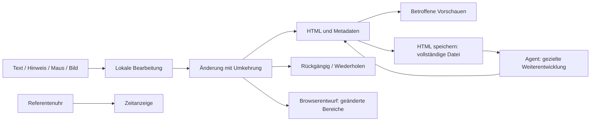

# ADR-001: Local editor transactions with HTML authority

## Status

Accepted, 2026-10-14. Implementation and scoped verification completed in the
fix, with the root code verdict
and execution evidence.
The separate historical UI decision
identified the later save-notice and [Task003](../specs/003-editor-usability.md)
scope; this ADR is no product-wide approval.

## Context

The presentation is a product surface of the collaboration described in
[intent.md](../../intent.md). Human contributions must remain easy and fast,
and the next agent must work from the complete saved HTML. The user retains
individual HTML/CSS/SVG design, sequential work and offline opening in modern
browsers. A large deck must not make a small text or guidance edit expensive.

The existing editor repeatedly captured the complete deck during local input.
The measured case
and independent council
motivated the user's explicit request to rewrite the approach.

## Decision

Retain authored DOM and schema1 metadata as the saved authority. Use explicit
local scopes and reversible transactions for text, metadata, geometry, images
and insertion. Central settlement orders ongoing input, provisional gestures,
history, navigation, pagehide and explicit saving. History must capture only
what is needed to reverse the affected change.

Use a source-bound browser draft journal of settled changed scopes. Store
introduced original image bytes separately and reference them from records.
Publish records before the head; validate a detached complete recovery candidate
before admitting it. Browser storage is optional convenience; HTML export must
remain available if storage is denied. Reject legacy drafts visibly rather than
replaying uncertain old state into the newly saved file.

Keep previews as bounded, disposable projections of the authored content. A
presenter clock update must update the clock alone. Use ordinary browser chrome
and an accessible in-page close control for the presenter.

Embed classic JavaScript and CSS in every complete ready HTML. Runtime framework,
server, installation and network access are unnecessary. Build-only minification
may reduce empty files provided offline behavior and popup serialization pass
actual browser checks. Designs and palettes remain independent.

The frozen contract and
root corrections define scopes,
APIs, settlement, resource budgets and preservation gates.

## Alternatives

- A metadata-only optimization would leave ordinary slide text, gestures and
  other editing paths dependent on full snapshots. The user rejected it.
- A canonical slide/element model could provide regular transactions, but would
  introduce a second document authority and require a preservation renderer for
  arbitrary existing HTML/CSS/SVG. Its migration cost is material here.
- GrapesJS or another editor platform offers mature general editing machinery.
  A lossless adapter for the existing single-file decks is unproven; adopting
  the platform would not remove that work. Existing presentation platforms remain
  future alternatives if the product's authoring model changes.
- A persistent app/server could improve saving and live collaboration. It crosses
  the current offline and sequential workflow boundary and adds deployment cost.

## Consequences

Locality is a contract across every runtime module, not a notes-only shortcut.
The implementation owns explicit cancellation, composition, async-target and
recovery semantics. It needs independent preservation and failure-path checks.
Load, recovery and complete export may perform full-document work; local input,
history, background persistence and timer ticks may not.

Task003 adds local slide deletion/movement scopes. Structural checkpoints carry
the final indexed slide-ID order because coalesced relative moves lose causal
dependencies; the vector contains no slide HTML. Ordinary movement history and
journal records keep stable anchors. The detached recovery candidate validates
the final order before admission. See the executed adversarial check.

Existing complete files keep their embedded runtime until explicitly upgraded.
The upgrade must preserve authored source, metadata, IDs and original assets.
The agent skill continues from the latest saved HTML rather than a fresh starter.
No integrated chat, template-selector UI or concurrent editing is introduced.
